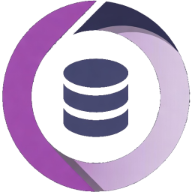

<h1 align="center">
  
  <div>Odoo GitHub Collector</div>
</h1>

<p align="center">
  Collects Odoo module metadata from GitHub/GitLab organizations, visualizes it on a web dashboard,
  and serves it to LLM clients over MCP.
</p>

<p align="center">
  <a href="https://github.com/Tardo/OGHCollector/actions/workflows/tests.yml"></a>
  <a href="./COPYING"></a>
</p>

---

## Overview

The project is a Rust workspace made of three services that share a single SQLite database:

| Service | Binary | Role |
| --- | --- | --- |
| **OGHCollector** | `oghcollector` | CLI that clones repositories, parses Odoo `__manifest__.py` files and writes the collected metadata to the database. |
| **OGHServer** | `oghserver` | actix-web dashboard that reads the database in read-only mode (module search, dependency graph, migration tracking, committer stats, etc). |
| **OGHMcp** | `oghmcp` | Read-only [MCP](https://modelcontextprotocol.io/) server exposing module, repository, dependency, code-analysis, and maintenance data as tools over a Streamable HTTP endpoint (`/mcp`), so any LLM client can reach it by URL. |

All three ship in the same Docker image, but run as separate Docker Compose services. A fourth,
one-shot `migrate` service prepares their shared SQLite database. The collector service stays up:
it collects on a schedule and, for repositories you can add webhooks to, as soon as they're pushed.

---

## Requirements

1. [Docker](https://docs.docker.com/get-docker/) and the Docker Compose plugin.
2. A GitHub and/or GitLab access token. The collector uses it for the API and, when a repository
   asks for credentials, for `git clone`/`fetch`, so private repositories the token can read are
   collected like public ones (public ones are still cloned anonymously):
   - [GitHub](https://docs.github.com/en/authentication/keeping-your-account-and-data-secure/managing-your-personal-access-tokens):
     classic token (no scope for public repositories, `repo` for private ones), or a fine-grained
     one with read access to *Contents*, *Pull requests*, *Commit statuses* and *Checks*.
   - GitLab (personal, group or project access token): `read_api`, plus `read_repository` for
     private projects.
   - GitHub personal accounts can't be collected whole (only organizations are listed): use
     `owner/repo` sources for their repositories.

---

## Quick Start

`docker-compose.yaml` always uses the image published on GitHub (`ghcr.io/tardo/oghcollector`, built
after the tests pass). Nothing is built locally: you only provide the configuration, mounted as
volumes.

```
oghcollector/
├── docker-compose.yaml   # from this repository
├── server.yaml           # dashboard settings (server.example.yaml, docs/server.md)
├── collector.yaml        # what to collect (collector.example.yaml)
└── workflows.yaml        # what to do with each module (workflows.example.yaml)
```

The three YAML files are mounted read-only into `/app` (`server` gets `server.yaml`; `collector` gets
`collector.yaml` and `workflows.yaml`), so editing them needs no rebuild:

```yaml
    volumes:
      - ./server.yaml:/app/server.yaml:ro
      - ./collector.yaml:/app/collector.yaml:ro
      - ./workflows.yaml:/app/workflows.yaml:ro
```

Create them before starting: if one is missing Docker makes a directory with that name. The
collector needs `workflows.yaml` always, and `collector.yaml` when it reads its sources from it
(the daemon, or no source argument).

```sh
export OGHCOLLECTOR_TOKEN_GH=<your GitHub token>   # see Requirements
docker compose up -d
docker compose exec -T collector oghcollector OCA 18.0   # collect now; otherwise on its schedule
```

Dashboard: `http://localhost:8080`. MCP: `http://localhost:8081/mcp`. They show nothing until the
collector has run once.

---

## Documentation

| Topic | Where |
| --- | --- |
| Collector: usage, sources (`collector.yaml`), scheduling, webhooks | [docs/collector.md](./docs/collector.md) |
| Workflows and actions (what happens to each module/PR/project) | [docs/workflows.md](./docs/workflows.md) |
| Dashboard and API settings (`server.yaml`) | [docs/server.md](./docs/server.md) |
| Workspaces, authentication, OIDC login | [docs/auth.md](./docs/auth.md) |
| MCP server for LLM clients | [docs/mcp.md](./docs/mcp.md) |
| Security/migration reports, license review, feeds, badges | [docs/reports.md](./docs/reports.md) |
| Environment variables, `docker-compose.override.yaml` | [docs/configuration.md](./docs/configuration.md) |
| Database and migrations | [docs/database.md](./docs/database.md) |
| Running the crates and frontend without Docker | [docs/development.md](./docs/development.md) |

---

## License

Distributed under the terms of the [GNU AGPLv3](./COPYING).
