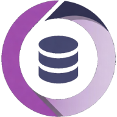

<h1 align="center">
  
  <div>Odoo GitHub Collector</div>
</h1>

<p align="center">
  Collects Odoo module metadata from GitHub/GitLab organizations, visualizes it on a web dashboard,
  and serves it to LLM clients over MCP.
</p>

<p align="center">
  <a href="https://github.com/Tardo/OGHCollector/actions/workflows/tests.yml"></a>
  <a href="./COPYING"></a>
</p>

---

## Overview

The project is a Rust workspace made of three services that share a single SQLite database:

| Service | Binary | Role |
| --- | --- | --- |
| **OGHCollector** | `oghcollector` | CLI that clones repositories, parses Odoo `__manifest__.py` files and writes the collected metadata to the database. |
| **OGHServer** | `oghserver` | actix-web dashboard that reads the database in read-only mode (module search, dependency graph, migration tracking, committer stats, etc). |
| **OGHMcp** | `oghmcp` | Read-only [MCP](https://modelcontextprotocol.io/) server exposing module, repository, dependency, code-analysis, and maintenance data as tools over a Streamable HTTP endpoint (`/mcp`), so any LLM client can reach it by URL. |

All three ship in the same Docker image, but run as separate Docker Compose services. A fourth,
one-shot `migrate` service prepares their shared SQLite database. The collector service stays up:
it collects on a schedule and, for repositories you can add webhooks to, as soon as they're pushed.

---

## Requirements

1. [Docker](https://docs.docker.com/get-docker/) and the Docker Compose plugin.
2. A GitHub and/or GitLab access token. The collector uses it for the API and, when a repository
   asks for credentials, for `git clone`/`fetch`, so private repositories the token can read are
   collected like public ones (public ones are still cloned anonymously):
   - [GitHub](https://docs.github.com/en/authentication/keeping-your-account-and-data-secure/managing-your-personal-access-tokens):
     classic token (no scope for public repositories, `repo` for private ones), or a fine-grained
     one with read access to *Contents*, *Pull requests*, *Commit statuses* and *Checks*.
   - GitLab (personal, group or project access token): `read_api`, plus `read_repository` for
     private projects.
   - GitHub personal accounts can't be collected whole (only organizations are listed): use
     `owner/repo` sources for their repositories.

---

## Quick Start

```sh
git clone git@github.com:Tardo/OGHCollector.git
cd OGHCollector

# 1. Build the shared image
docker compose build

# 2. Start the dashboard (:8080), MCP (:8081) and the collector (webhooks on :8082).
#    Compose applies migrations first.
docker compose up -d

# 3. Populate the database now; otherwise the collector does it on its next scheduled run
docker compose exec -T collector oghcollector OCA 18.0
```

The dashboard is now available at `http://localhost:8080` and the MCP endpoint at `http://localhost:8081/mcp`.

> `server` and `mcp` open the database **read-only**. Compose completes `migrate` before starting
> them or `collector`; they will not serve collected module data until `collector` has run at
> least once. `server`, `mcp` and `collector` restart with `unless-stopped`. Upgrading from a
> version that used Ofelia: `docker compose up -d --remove-orphans` removes its container.

---

## Database & Migrations (Diesel)

The schema is managed with [Diesel](https://diesel.rs/); migration files live in [`migrations/`](./migrations).

### With Docker (the normal workflow)

The one-shot `migrate` service creates the database file if needed and applies pending migrations.
Compose waits for it to succeed before starting `server`, `mcp`, or `collector`.
Run the collector to populate the schema with module data:

```sh
docker compose exec -T collector oghcollector OCA 18.0
```

After upgrading to a version with new migrations, run `docker compose up -d --build` to recreate
the migration job and the long-running services. To apply migrations without starting them, run
`docker compose run --rm migrate`.

### Local (non-Docker) development

If you're running the crates directly with `cargo run`, use the standalone migration runner:

```sh
cargo run -p sqlitedb --bin migrate -- data/data.db
```

> `crates/sqlitedb/src/schema.rs` is regenerated by Diesel, never hand-edited. `diesel.toml` sets
> `sqlite_integer_primary_key_is_bigint = true` and applies `crates/sqlitedb/schema.patch` to fix
> non-null primary keys and wider integer columns. Update the patch, not the generated schema.

See [`docs/development.md`](./docs/development.md) for the full non-Docker development setup.

---

## OGHServer

### Configuration

Mount a volume to `/app/server.yaml` (JSON is also supported) to override the defaults:

| Name | Type | Description | Default |
| --- | --- | --- | --- |
| `bind_address` | string | Address to bind the server on | `0.0.0.0` |
| `port` | int | Port to bind the server on | `8080` |
| `workers` | int | Number of worker processes | `2` |
| `template_autoreload` | bool | Reload templates automatically when they change | `false` |
| `allowed_origins` | list of strings | Allowed cross-origin CORS origins. Empty denies cross-origin browser access. | `[]` |
| `cookie_key` | string | Key used to sign session cookies; must be at least 64 bytes, otherwise a new key is generated at startup | |
| `upload_limit` | int | Maximum upload size, in bytes | `2097152` |
| `cache_ttl` | int | Seconds a cache entry stays valid | `3600` |
| `db_pool_max_size` | int | Maximum number of pooled DB connections | `15` |
| `doodba_max_modules` | int | Maximum number of modules accepted per Doodba tool request (converter/dependency-resolver/migration-plan); larger requests are rejected with `400` | `500` |
| `mcp_info_enabled` | bool | Show the `/mcp` page explaining how to connect popular LLM clients to the MCP endpoint, and its nav link | `false` |
| `workflow_editor_enabled` | bool | Show the `/workflows` editor (see [Workflows](#workflows)) and its nav link. **It publishes the `workflows:` section of the collector config** (prompts, AI hosts, `api_key_env` names), never its sources or actions | `false` |
| `collector_config` | string | Collector config the editor reads the workflows from (`config` crate path, extension optional) | `collector` |
| `scan_enabled` | bool | Enable the live instance scanner. Disabled by default because it creates outbound requests; enable it only behind the access controls appropriate for your deployment. | `false` |
| `mcp_url` | string | Public URL of the MCP endpoint, displayed on that page | `http://localhost:8081/mcp` |
| `trusted_proxies` | list of strings | IPs/CIDRs (e.g. your reverse proxy's address, or the Docker network subnet) allowed to set `X-Forwarded-For`/`Forwarded`; honored only when the request's direct TCP peer matches one of these, otherwise the headers are stripped and the real peer address is used instead. Needed for correct client IPs in access logs (and `REQ_BASE_URL` scheme/host) behind Traefik/nginx/etc. | `[]` |
| `seo_enabled` | bool | Allow search engines/social previews to index and share the site: `/robots.txt` returns `Allow: /` instead of `Disallow: /`, and pages get a canonical link plus Open Graph/Twitter Card meta tags. Off by default so nothing is shared/indexed until explicitly opted in. | `false` |
| `semantic_search_enabled` | bool | Enable embedding-based "Semantic" search (the `/v1/semantic-search` endpoint, the "Semantic" option in the search dropdowns, and its entry on the `/api` page). When off, the option is hidden, the route is not served and the embedding model is never downloaded or loaded in memory. On by default so the feature keeps working unless explicitly disabled. | `true` |
| `health_score_enabled` | bool | Show the synthetic "Health" card (0-100 over security findings, human commit activity, "Required by" and Odoo series) on the module page. The detail cards stay either way; the `health` field is always in `/v1/module/*`. | `true` |

```yaml
# docker-compose.override.yaml
services:
  server:
    volumes:
      - ./server.yaml:/app/server.yaml
```

---

## OGHCollector

### Usage

```sh
docker compose exec -T collector oghcollector                      # every source in collector.yaml
docker compose exec -T collector oghcollector --config <file>      # every source in another config file
docker compose exec -T collector oghcollector --check              # validate the config, print its jobs
docker compose exec -T collector oghcollector <origin> <version> [git_type]  # a single source/version
```

Without a source, the collector runs every job declared in [`collector.yaml`](./collector.yaml)
(see [Collector config](#collector-config)). The single-run form takes:

- `<origin>`:
  - The name of an organization — all its repositories are scanned (on GitLab, only the projects directly in the group: list each subgroup as its own source), up to 12,700 GitHub repositories or 25,400 GitLab projects.
  - The name of a repository (`owner/repo`; on GitLab also `group/subgroup/project`), optionally followed by `:` and a comma-separated list of folders to scan. On GitLab, `group/subgroup` that isn't a project is scanned as a group. Each folder must start with `/` (it's appended directly to the clone path). To scan the repo root *as well as* subfolders, add a trailing comma (an empty entry means the root): `:/addons,` scans `/addons` plus the root.
- `<version>`: Odoo version to collect (e.g. `18.0`).
- `[git_type]`: Optional git client to use: `GH` (GitHub, default), `GL` (gitlab.com), or `GL:<api_url>` (a GitLab API URL).

> GitLab collections use the first segment of a project's path as the organization, so two projects
> with the same name in different subgroups of one group are stored as the same repository: collect
> only one of them.

### Examples

```sh
# Odoo core modules, 18.0 (GitHub)
docker compose exec -T collector oghcollector odoo/odoo:/addons,/odoo/addons 18.0

# OCA/web modules, 18.0 (GitHub)
docker compose exec -T collector oghcollector OCA/web 18.0

# All OCA modules, 18.0 (GitHub)
docker compose exec -T collector oghcollector OCA 18.0

# All MyGroup modules, 18.0 (self-hosted GitLab)
docker compose exec -T collector oghcollector MyGroup 18.0 GL:https://mygitlabinstance.com/api/v4/
```

### Collector config

`collector.yaml` declares what to collect: organizations/groups or repositories, the Odoo versions
of each and the folders that hold their modules. It's what the scheduled job runs.

```yaml
templates:                          # named module-folder layouts, written once
  odoo: [addons, odoo/addons]
  addons: [addons]

sources:
  - source: odoo/odoo               # organization/group, or owner/repo
    template: odoo                  # module folders from `templates`
    versions: [17.0, 18.0, 19.0]    # Odoo versions (branches) to collect
  - source: OCA                     # no template/paths: modules at each repo's root
    versions: [18.0]
  - source: Acme/erp
    template: addons
    paths: [third_party]            # extra folders, added after the template's
    versions: [18.0]
  - source: MyGroup/odoo            # GitLab: a project, or a subgroup (its projects, not its subgroups')
    git: GL                         # GH (default) or GL
    base_url: https://mygitlabinstance.com/api/v4/  # self-hosted GitLab (default: gitlab.com)
    template: addons
    versions: [18.0]
    workspaces: [mygroup]           # portal workspaces it's listed in (default: all)
    pull_requests: full             # every PR/MR analyzed (default: migration, see below)
```

`workspaces` groups repositories in the portal, see [Workspaces](#workspaces).

Folders are relative to each repository root (a leading `/` is optional, `""` or `.` is the root).
A repository whose layout changed between versions (OpenERP's `openerp/addons` vs Odoo's
`odoo/addons`) is listed once per layout, each with its own `versions`.

The schema is meant to be generated as well as hand-written: every value has a fixed type, the
reuse is by name (`template`) rather than YAML anchors, unknown keys are errors (a typo never falls
back silently to a default), and the same keys work as JSON or TOML (`--config collector.json`).
`oghcollector --check` validates the file and prints its jobs, one per line, without running them
(exit status `2` on an invalid file), so a pipeline can check a generated config before deploying it.

The file is validated before anything runs. Jobs then run in order, one `oghcollector <source>[:<paths>] <version> <git>`
child process per version: a failed job is logged and skipped, the rest still run, and the run
exits non-zero at the end. The embedding pass runs once, after the last job.

A job fails when anything goes wrong in it, not only when it crashes: an API error (a bad or
expired token, a rate limit that outlasts the retries), a repository that can't be cloned or
fetched, a busy lock, a missing token, a crash, an out-of-memory kill or a hang (a job still
running after 4 hours is killed; stalled HTTP requests and git transfers time out on their own
well before that). What it did collect is
kept. Each failed job is also recorded as a `Scan failed for '<source>' [<version>]: <first error>`
error in the portal's event log (`/logs`, and its Atom feed). API rate limits are waited out
(up to an hour) and server/network errors retried before giving up.

`docker-compose.yaml` bind-mounts `./collector.yaml` and `./workflows.yaml` read-only into `/app`,
so edits apply on the next run without rebuilding. If your editor saves by replacing the file (vim, most
IDEs), the container keeps seeing the old copy until `docker compose restart collector`. The image
also ships the repository's copy as a fallback for plain `docker run`.

### Workflows

The collector itself only walks the sources: it clones them and finds every module folder. What
happens to each module is a *workflow*, a graph of nodes, and a source runs the ones it names. The
`default` workflow is what the collector always did (a test checks it leaves exactly the same data
and events), so a source without `workflows:` behaves as before; `workflows: []` only walks.

Workflows live in `workflows.yaml` at the repository root, next to `collector.yaml` (in Docker both
are mounted from there, so editing them needs no rebuild). The binary also carries the copy it was
built with, used only when there's no `workflows.yaml` next to the collector config: when there is
one, it's the whole list (a workflow taken out of it is gone). `collector.yaml` may have a
`workflows:` too; its definitions replace any of the same name. A workflow with `enabled: false`
doesn't run even where a source names it (the job logs a warning); it's still checked. The shipped
`workflows.yaml` has `default` and one more, off: `demo_pr_review`, an AI reviewing the PRs that
bring grave security findings or migration notes (see [Actions](#actions)).

```yaml
# default (in workflows.yaml): unchanged modules only get their manifest stored
default:
  on: module
  nodes:
    - {id: changed, type: if, when: not unchanged, then: stats, else: store}
    - {id: stats, type: git_stats, next: analyze}
    - {id: analyze, type: analyze_code, next: security}
    - {id: security, type: security, next: migration}
    - {id: migration, type: migration_notes, next: store}
    - {id: store, type: store_module, next: osv}
    - {id: osv, type: osv}
```

A workflow starts at its first node and follows `next` (or, for `if`, `then`/`else`) until a node
has none. The portal can show them as a graph and build them visually: with
`workflow_editor_enabled` (server config), `/workflows` lists those of `workflows.yaml` (or the
built-in copy) and the collector config, lets you change them or draw new ones (drag nodes, link
their outputs, fill in their fields, switch them on or off) and gives the YAML to paste into
`workflows.yaml`, checked as you go by the same
rules as `oghcollector --check`. Nothing is saved there. Each node's place in the editor goes in
the YAML as `pos: [x, y]` (the collector ignores it), so a shared workflow opens laid out as it was
left; one without positions is laid out for you. Sources pick workflows by name (here
`workflows.yaml` and `collector.yaml` in one listing):

```yaml
workflows:
  security_only:                    # names: lowercase letters, digits, '-' and '_'
    on: module                      # each module a job finds (the only trigger for now)
    nodes:
      - {id: changed, type: if, when: not unchanged, then: stats, else: store}
      - {id: stats, type: git_stats, next: security}   # committers and folder size
      - {id: security, type: security, next: grave}
      - {id: grave, type: if, when: "security.grave > 0", then: alert, else: store}
      - id: alert
        type: log
        event: security
        severity: error
        message: "{{ technical_name }} [{{ odoo_version }}]: {{ security.grave }} grave finding(s)"
        next: store
      - {id: store, type: store_module}

sources:
  - source: MyGroup
    git: GL
    versions: [18.0]
    workflows: [security_only]
```

| Node | Does | Fields |
| --- | --- | --- |
| `if` | Goes to `then` when the `when` condition holds, else to `else` (none: ends) | `when`, `then`, `else` |
| `read_manifest` | Reads the manifest | `next` |
| `git_stats` | Committers and folder size, from git (without it they aren't updated: the module page's activity and size stay as stored) | `next` |
| `analyze_code` | Analyzes the `.py`/`.xml`/`.csv` files (views, models, records, routes) | `next` |
| `security` | [Security rules](#security-and-migration-reports) over that analysis | `next` |
| `migration_notes` | Migration notes for the collected version | `next` |
| `store_module` | Stores the module with what the workflow computed (a section it didn't compute keeps its stored data), its dependencies, and logs the usual events | `next` |
| `osv` | Known vulnerabilities of the pinned Python dependencies `store_module` just added | `next` |
| `log` | An event in `/logs`: `event` type (default `workflow`), `severity` (`info`, `success`, `warning`, `error`) and a `message` template | `next`, `event`, `severity`, `message` |
| `ai` | Asks an AI; the answer is `ai.<node id>` for the nodes after it. Outward: see [Actions](#actions) | `next`, `provider`, `model`, `prompt`, `system`, `url`, `api_key_env`, `max_tokens`, `timeout` |
| `pr_open` | Opens a PR/MR with one commit, the `patch` template (a unified diff, e.g. `{{ ai.fix }}`), on the module's version branch. Outward | `next`, `title`, `body`, `patch` |

`on: pull_request` workflows run on every PR/MR a job tracks (see the source's `pull_requests`),
after it's stored and analyzed. Besides `if`, `log` and `ai`, they have:

| Node | Does | Fields |
| --- | --- | --- |
| `pr_comment` | Comments on the PR/MR (`body` template). Outward | `next`, `body` |
| `pr_edit` | Replaces its description (`body` template; `pr.description` is the current one). Outward | `next`, `body` |
| `pr_review` | Reviews it: the `patch` template's changes (a unified diff against the PR's head, e.g. `{{ ai.review }}`) as suggestions its author applies in one click, `body` as the review's text. Comments only, never approves or asks for changes. Needs `pull_requests: full`. Outward | `next`, `body`, `patch` |

A node computes what it needs that no earlier node computed (`security` analyzes the code,
`store_module` reads the manifest). Conditions and messages are
[Jinja](https://docs.rs/minijinja/latest/minijinja/syntax/) over these variables:
`technical_name`, `path` (the module folder), `source_path`, `org`, `repo`, `odoo_version`,
`is_new` (not stored before), `unchanged` (same last commit as stored, analyzed by the same
analyses as the source's storing workflow),
`last_commit.hash|author|date|name`, `manifest.name|version|license|category|author|installable|depends`,
`security.grave|minor|findings` and `migration.count|notes`; the last three are empty until a node
computes them. `file('models/x.py')` returns a file of the module (up to 100 KB; nothing outside
its folder).

In `pull_request` workflows: `org`, `repo`, `odoo_version`,
`pr.number|title|author|labels|draft|ci_status|head_sha|head_ref|url|description`, `pr.is_new`
(first seen), `pr.head_changed`, `pr.ci_changed` (checks just turned green or red), `pr.is_ours`
(opened by `pr_open`), and `modules`, one `{name, port, analysis}` per module it changes
(`analysis` with `pull_requests: full`). Over those, like a module workflow's own:
`security.grave|minor|findings` (only the findings the PR brings, not those of the merged module)
and `migration.count|notes`, each item with its `module` (empty without the analysis). `diff()` returns its changes (up to 200,000 characters;
`full` sources only, the others never fetch the PR head). Both kinds see `ai.<node id>`.

- `oghcollector --check` validates every workflow (types, fields, node references, cycles,
  conditions, templates) along with the sources. A source can store modules from one of its
  workflows only, and each workflow starts from a clean slate (they don't see each other's
  results).
- A module's stored analysis is tagged with which analyses produced it, so adding `security` or
  `migration_notes` to a source's workflow analyzes its unchanged modules once more.
- A failing node logs a warning and stops that workflow for that module; the job goes on.
- Stored modules a job no longer finds in the repository are deleted, whatever the workflows do.
- Which PRs/MRs are tracked (and analyzed) still depends on the source's `pull_requests`.

#### Actions

`ai`, `pr_comment`, `pr_edit`, `pr_review` and `pr_open` reach outside the collector, so they only **log what
they would do** (`[dry-run] ...` events in `/logs`, with what they'd send) until the source lists
them:

```yaml
workflows:
  review:
    on: pull_request
    nodes:
      - {id: ours, type: if, when: "not pr.is_ours", then: ask}
      - id: ask
        type: ai
        provider: anthropic              # or openai: OpenAI, Ollama, LM Studio, vLLM...
        model: claude-opus-5-5
        api_key_env: ANTHROPIC_API_KEY   # env var, or the anthropic_api_key Docker secret
        prompt: "Review this Odoo {{ odoo_version }} change:\n{{ diff() }}"
        next: comment
      - {id: comment, type: pr_comment, body: "{{ ai.ask }}"}
  suggest:
    on: pull_request
    nodes:
      - {id: ours, type: if, when: "not pr.is_ours", then: ask}
      - id: ask
        type: ai
        provider: anthropic
        model: claude-opus-5-5
        api_key_env: ANTHROPIC_API_KEY
        prompt: |
          Odoo {{ odoo_version }} PR. Reply with a unified diff against its head that fixes
          migration problems, changing only lines this diff shows, or nothing if all is fine:
          {{ diff() }}
          Migration notes: {{ modules | map(attribute='analysis') | list | tojson }}
        next: review
      - {id: review, type: pr_review, body: "AI suggestions: check them before applying.", patch: "{{ ai.ask }}"}
  fix_views:
    on: module
    nodes:
      - {id: todo, type: if, when: "not unchanged", then: notes}
      - {id: notes, type: migration_notes, next: any}
      - {id: any, type: if, when: "migration.count > 0", then: ask}
      - id: ask
        type: ai
        provider: openai
        url: http://ollama:11434/v1      # a local model
        model: qwen2.5-coder
        prompt: "Write a unified diff (paths from the repo root, under {{ source_path }}/) fixing: {{ migration.notes | tojson }}"
        next: open
      - {id: open, type: pr_open, title: "[{{ odoo_version }}][FIX] {{ technical_name }}: migration notes", patch: "{{ ai.ask }}"}

sources:
  - source: MyGroup
    git: GL
    versions: [18.0]
    pull_requests: full
    workflows: [default, fix_views, review, suggest]
    actions: [ai, pr_comment, pr_review] # pr_open stays dry-run
```

- **Once per item.** A ledger (`workflow_action`) records every action: a comment or description
  edit runs once per PR head (a new push may get another), `pr_open` once per module and version,
  and dry-run reports once too. An AI answer is kept and reused while the item, prompt and settings
  are the same, so an unchanged module or PR never pays twice. A failed action isn't recorded and
  is retried on the next run.
- **Tokens.** PR/MR actions use a write token of their own, never the read one:
  `OGHCOLLECTOR_WRITE_TOKEN_GH` / `_GL` (or the `gh_write_token` / `gl_write_token` Docker secret);
  without it they fail with a warning. AI keys come from the env var named in `api_key_env` (or
  the Docker secret of the same name in lowercase); none of them is ever logged.
- **Limits.** A job makes at most `OGHCOLLECTOR_AI_LIMIT` (default `20`) AI calls, each waiting up
  to `timeout` seconds (default `300`, at most `600`); `max_tokens` defaults to `16000`. Items past
  the limit wait for the next run.
- **Gates that are true once.** `pr.head_changed`, `pr.ci_changed` and `not unchanged` only hold on
  the run that sees the change: an action that fails then (an AI timeout, the call limit, a missing
  token) isn't retried for that head or commit, and turning a node live doesn't act on items already
  seen. The ledger already stops repeats, so gate on them only when that's what you mean. A module
  workflow gated on `not unchanged` (like `fix_views`) only ever looks at modules with new commits;
  without the gate it analyzes every module on every run (its AI answers and PRs are still once).
- **Bot PRs.** A PR opened or edited by these nodes comes back through the webhooks; gate PR
  workflows on `not pr.is_ours` so they don't review their own work.
- **The demo, `demo_pr_review`** (in `workflows.yaml`): on PRs that aren't its own and bring a
  grave security finding or a migration note, it asks `claude-opus-5-5` for a fix as a diff of the
  PR's lines and posts a review listing the findings, with the fix as suggestions. It ships with
  `enabled: false`: to try it, set `enabled: true` and name it in a `pull_requests: full` source
  (`workflows: [default, demo_pr_review]`), which only logs what it would ask and post; then add
  `actions: [ai]` to have it ask (`/logs` then says how many suggestions it would post, on which
  files), and `pr_review` to post them. Set
  `ANTHROPIC_API_KEY` (or the `anthropic_api_key` Docker secret) and the write token. Change it
  in `workflows.yaml` itself, or build a copy at `/workflows`.
- **`pr_review` suggestions.** Each hunk of the diff is found by its text in the file at the PR's
  head (an AI's line numbers are often off), trimmed to the lines it changes, and posted as a
  one-click suggestion (GitHub: one review, `event: COMMENT`; GitLab: a thread each, then a note).
  The forges only take them on lines the PR's own diff shows: whatever falls outside, isn't found,
  or adds or deletes whole files goes in the review's text as a diff to apply by hand, and so does
  a review GitHub refuses (one bad line sinks it: it's sent again as text) or a GitLab thread it
  refuses. A GitLab MR pushed to since the PR step waits for the next run (its new head). Dry-run
  logs how many suggestions it would make and on which files; it only has something to say when
  `ai` is live (a dry-run `ai` answers "").
- **`pr_edit` replaces** the description. A `body` that appends to `pr.description` grows on every
  new head unless it checks for its own text: `...`.
- **Dry-run reports** are capped at 20 per job; the rest are reported by later runs (a line says how
  many were held back).
- **`pr_open` safety.** The branch is always `ogh/<workflow>/<module>-<version>`, never pushed
  over an existing one (an existing branch is an earlier attempt: only its missing PR is created).
  The patch must only add, edit or delete regular files inside the module folder (no renames out of
  it, no mode changes, symlinks, submodules or binaries) and apply cleanly; dry-run checks all that
  and logs which files it would change. It's committed as `OGHCOLLECTOR_COMMIT_AUTHOR` ("Name
  <email>", default `OGHCollector <oghcollector@localhost>`) in a worktree of its own. **A branch
  pushed to the repository runs its CI with the repository's secrets**, and AI-written code (whose
  prompt may include text from anyone's PR) then runs there: enable `pr_open` only where that's
  acceptable.
- Sending a private repository's code to a cloud AI is up to you: it only happens for sources
  that list `ai`, to the `url`/provider the workflow names.

### Workspaces

A workspace is a named view of the portal over some sources, e.g. your company's repositories next
to OCA and Odoo. Give a source `workspaces: [mycompany]` in `collector.yaml` (several names are
fine; entries with the same `source` share the union). Names are letters, digits, `-` and `_`.

- As soon as one repository has a workspace, the portal's top bar shows a selector (*All
  workspaces* by default). The choice is kept in a `workspace` cookie, per browser.
- Picking one limits the listings to that workspace's repositories **plus every repository without
  `workspaces`** (OCA, Odoo...): dashboard, modules, search (including semantic search), atlas,
  committers and committer pages, OSV, localization and the `/v1/search*` and `/v1/repository` API.
- Module pages, dependency trees, license review, Doodba tools, badges, feeds, `/logs` and the
  sitemap always see everything, so a dependency on another workspace's module still resolves and
  its page opens. The MCP endpoint isn't filtered either.
- The workspaces are rewritten by every collector run of the source; a new one shows up in the
  selector after `cache_ttl`. A manual `oghcollector <source> <version> <git>` leaves them as
  they are; append `a,b` to change them, or `all` to show it in every workspace (same as a source
  without `workspaces`).

> A workspace is a filter, not access control: anyone can pick any workspace or open any module
> page. Keep an instance that collects private code behind authentication or a private network
> (see [Authentication](#authentication)).

### Authentication

The recommended way to provide API tokens is through Docker secrets, so they never end up in
`docker-compose.yaml` or shell history. The collector automatically reads `/run/secrets/gh_token` and
`/run/secrets/gl_token` if present:

```yaml
# docker-compose.override.yaml
services:
  collector:
    secrets:
      - gh_token
      - gl_token

secrets:
  gh_token:
    file: ./gh_token.txt
  gl_token:
    file: ./gl_token.txt
```

Git gets the token from a credential helper scoped to the repository's host, set up through
`GIT_CONFIG_*` environment variables. It's only used when the server asks for credentials, it's never
written to the clones' `.git/config` (in the data volume), and it never shows up in the process list.

> Collected private repositories are as visible as public ones: module metadata, code analysis and
> security findings show up on the dashboard, `/api/v1`, the MCP endpoint, feeds and badges. Keep an
> instance that collects private code behind authentication or a private network (both `server`
> and `mcp`).

Secret contents are trimmed, so a trailing newline is fine. A nonempty secret takes precedence;
an absent or empty secret falls back to the corresponding environment variable.

Alternatively, without secrets, set `OGHCOLLECTOR_TOKEN_GH` / `OGHCOLLECTOR_TOKEN_GL` as environment
variables (used as a fallback when the corresponding secret file isn't found).

### Scheduling updates

The `collector` service runs `oghcollector --listen`, which stays up and runs collection jobs one
at a time, each as its own child process (so a failed or hung job is recorded and skipped exactly
as in a [`collector.yaml`](#collector-config) run):

- **Schedule**: every source in `collector.yaml` at 00:00, 06:00, 12:00 and 18:00 UTC (every
  multiple of `OGHCOLLECTOR_SCHEDULE_HOURS`, default `6`; `0` turns it off). By default that's
  OpenERP (6.1–9.0), Odoo (10.0–20.0) and OCA (6.1–20.0). Nothing runs at startup, so a redeploy
  doesn't start a batch. A job still waiting from the previous batch isn't queued twice.
- **Webhooks**: a push to a version branch (`18.0`, ...) of a repository some source collects, a
  pull/merge request against one, or its CI finishing, queues that repository and version alone,
  ahead of any scheduled job still waiting, so it starts as soon as the running job ends. Several
  deliveries for the same repository and version while it waits are one job. The embedding pass
  runs whenever the queue empties.

Each job also refreshes the open pull/merge requests of its repositories and version, as the
source's `pull_requests` says:

- `migration` (default, meant for public sources like OCA and Odoo): only requests on an OCA port
  branch (`18.0-mig-<module>`), with their CI. Nothing is fetched nor analyzed.
- `full` (meant for your own repositories): every request. It's mapped to the modules it changes
  (from its diff, no extra API calls) and each module is analyzed at the request's head with the
  same rules as merged code; its code is never checked out in the shared clone, only extracted into
  the job's own temporary directory, and its manifest is parsed, not executed.

Requests whose head didn't change aren't analyzed again, and a job analyzes at most `OGHCOLLECTOR_PR_ANALYSIS_LIMIT` (default `100`; repository
by repository, each one's most recently active first) and looks up at most 500 GitHub CI states (2
requests each, a share of the token's hourly limit): on the first run the backlog is spread over the
next ones, so the first runs after upgrading are slower and a request only shows its analysis once
its turn comes. The module
page lists them in its *Pull requests* tab. For `full` sources, CI turning green or red,
merges/closes and grave findings a request introduces are logged as `pull_request` events (`/logs`, the feed with
`type=pull_request`), only against a state seen before, so the first run over thousands of open
requests stays quiet.

`collector.yaml` is read again for every scheduled run and webhook, so editing it needs no restart.
Follow it with `docker compose logs -f collector`; failed jobs are also in the portal's event log.
A manual `docker compose exec -T collector oghcollector ...` still works, but it fails on the org
lock while the daemon is collecting the same org.

#### Webhooks

You can only add webhooks to repositories or organizations/groups you administer, so OCA and Odoo
stay on the schedule. Expose port `8082` (behind your HTTPS reverse proxy), set a secret per
provider, and add a hook with the same secret and these events:

- GitHub: *Pushes*, *Pull requests*, *Check suites* and *Statuses*.
- GitLab: *Push events*, *Merge request events* and *Pipeline events*.


| | Hook URL | Secret | Where |
| --- | --- | --- | --- |
| GitHub | `https://<host>/hooks/github`, content type `application/json` | `gh_webhook_secret` Docker secret or `OGHCOLLECTOR_WEBHOOK_SECRET_GH` | Repository or organization → *Settings → Webhooks* |
| GitLab | `https://<host>/hooks/gitlab` | `gl_webhook_secret` Docker secret or `OGHCOLLECTOR_WEBHOOK_SECRET_GL` (*Secret token*) | Project or group → *Settings → Webhooks* (group hooks need Premium) |

```yaml
# docker-compose.override.yaml
services:
  collector:
    secrets:
      - gh_webhook_secret

secrets:
  gh_webhook_secret:
    file: ./gh_webhook_secret.txt   # e.g. `openssl rand -hex 32`
```

A provider without a secret has no endpoint (and with neither, nothing listens): a valid delivery
starts clones, so unsigned ones are never accepted. GitHub deliveries are checked against their
`X-Hub-Signature-256` HMAC, GitLab ones against `X-Gitlab-Token`. A CI event only names a commit,
so it's mapped through the stored head of an open request (unknown commits are ignored). Other
events, other branches, deleted branches, unfinished CI and repositories no source collects get a
`200` and are ignored; a queued one gets a `202` listing its jobs (visible under the hook's *Recent
deliveries*).

The queue lives in memory: deliveries still waiting when the collector restarts are dropped, and
the next scheduled run catches up.

---

## OGHMcp

Streamable HTTP MCP endpoint exposing module and repository discovery, module metadata, documentation,
dependencies, code analysis, version history, version-to-version comparison, license review and
committer activity over the same data as `oghserver`.

### Configuration

Mount a volume to `/app/mcp.yaml` (JSON is also supported) to override the defaults. Every key can also be
set via an `OGHCOLLECTOR_MCP_`-prefixed environment variable (e.g. `OGHCOLLECTOR_MCP_CACHE_TTL`), which
takes precedence over the file:

| Name | Type | Description | Default |
| --- | --- | --- | --- |
| `cache_ttl` | int | Seconds cached module and repository query results stay valid | `3600` |

```yaml
# docker-compose.override.yaml
services:
  mcp:
    volumes:
      - ./mcp.yaml:/app/mcp.yaml
```

By default the MCP server only accepts requests whose `Host` header is `localhost`, `127.0.0.1` or `::1`
(DNS-rebinding protection). For any real deployment, set `OGHCOLLECTOR_MCP_ALLOWED_HOSTS` to the
hostname(s)/IP(s) your clients actually connect to:

```yaml
# docker-compose.override.yaml
services:
  mcp:
    environment:
      OGHCOLLECTOR_MCP_ALLOWED_HOSTS: mcp.example.com,203.0.113.10
```

> `oghmcp` has no authentication of its own. If `oghserver` sits behind auth or a private network,
> give `oghmcp` the same treatment.
>
> `scan_instance` is disabled in MCP unless `OGHCOLLECTOR_SCAN_ENABLED=true`. Enable it only where
> access to the endpoint is controlled, as it makes outbound requests.

---

## Security and migration reports

- Static findings are review priorities, not confirmed vulnerabilities. "Grave" (`error`) is
  reserved for high-precision cases: SQL built by string formatting from caller-controlled input
  (an RPC-callable method's parameters, the request payload or the context; CWE-89), routes
  writing the raw request payload into `write()`/`create()` without access checks (CWE-915),
  write/unlink ACLs open to every user or to portal/public, always-true portal/public record
  rules, CSRF disabled on authenticated state-changing routes, and write access to security
  models. Other SQL formatting, `eval`/`exec`, pickle/unsafe YAML, `shell=True`,
  `verify=False` and user-writable `Html(sanitize=False)` fields are minor review items.
- Noise control: `test_*` / "Tests"-category modules (never installed in production) are not
  scanned, intentional broad-access naming (`public`, `all`, portal ACLs named after their
  group) and create-only grants are not grave, an always-true portal rule over the module's own
  deny-all ACL is ignored, and the markers OCA uses for reviewed hits
  (`# pylint: disable=sql-injection`, `# noqa`, `# nosec`) are honored. MCP
  `get_module_code_analysis` includes `security_warnings` and migration notes with source
  file/line where available.
- Migration notes know which Odoo version each API change happened in (checked against Odoo's
  source): "Migrating to X.0: ..." for a module still below it, "Since X.0: ..." when the
  module's own version already ignores or rejects that code. Repeats of one note within a file
  are folded into one line.
- Live scans return `findings`, endpoint evidence and `checks` (`passed: null` means inconclusive).
  The arbitrary numeric `score` has been removed from the JSON response and dashboard. HTTP 200
  alone does not establish sensitive-file or database exposure, and module names are not used to
  guess a running Odoo version.

Each module stores the `ANALYSIS_VERSION` (`crates/collector/src/analyzer.rs`) its findings were
computed with (and which analyses ran, see [Workflows](#workflows)); bump it whenever the extractor
or the security/migration rules change, and the next collector run re-analyzes every module, even
those whose branch gets no new commits. To force a
full re-analysis regardless, set `OGHCOLLECTOR_FORCE_REANALYZE=1`:

```sh
OGHCOLLECTOR_FORCE_REANALYZE=1 cargo run --bin collector -- OCA 18.0
```

## License review, feeds, badges and version comparison

- **License review**: every module page, the Doodba dependency resolver, shared packs, MCP
  (`get_module_dependencies`, `review_module_licenses`) and `GET /v1/license-check` check the
  manifest licenses of the modules *and their whole dependency closure*: the license the combined
  work must be distributed under (e.g. an LGPL-3 module on an AGPL-3 dependency is effectively
  AGPL-3), proprietary modules pulled in, and conflicts (proprietary code on GPL/AGPL, GPL-2-only
  mixed with v3). It's a heuristic to catch problems early, not legal advice. In CI:

  ```sh
  curl -s "https://ommd.example/v1/license-check?odoo_version=18.0&modules=sale_order_type,web_responsive" \
    | jq -e '[.findings[] | select(.severity == "error")] | length == 0'
  ```

- **Atom feeds**: `/feed.atom` (new/updated modules, migration PRs, vulnerabilities; filter with
  `type`, `odoo_version`, `q`) and `/module/{org}/{technical_name}/feed.atom` to follow one
  module. Works with any feed reader or Slack/Teams RSS integration.
- **README badges**: `/badge/{org}/{technical_name}/{versions|status|license|security}.svg`; module
  pages have copy-ready Markdown/reStructuredText/HTML snippets under "Embed badges".
- **Version comparison**: "Compare" on a module page (or `GET /v1/compare/{module}?from=&to=`, MCP
  `compare_module_versions`) shows what changed between two Odoo versions: manifest, dependencies,
  models/fields/methods, views and HTTP routes.

## Environment Variables

| Variable | Used by | Purpose |
| --- | --- | --- |
| `OGHCOLLECTOR_TOKEN_GH` | collector | GitHub API token (fallback if the `gh_token` Docker secret isn't set) |
| `OGHCOLLECTOR_TOKEN_GL` | collector | GitLab API token (fallback if the `gl_token` Docker secret isn't set) |
| `DATABASE_URL` | Diesel CLI | SQLite connection string (local, non-Docker development only) |
| `OGHCOLLECTOR_DB_PATH` | server, mcp, migrate | Path to the SQLite database (default `data/data.db`); the MCP's first CLI argument takes precedence. The collector always writes to `data/data.db`. |
| `OGHCOLLECTOR_SCAN_ENABLED` | server, mcp | Enable live instance scans. Disabled by default. |
| `OGHCOLLECTOR_MCP_BIND_ADDR` | mcp | HTTP bind address (default `0.0.0.0:8081`) |
| `OGHCOLLECTOR_MCP_ALLOWED_HOSTS` | mcp | Comma-separated `Host` header allowlist (default `localhost,127.0.0.1,::1`) |
| `OGHCOLLECTOR_MCP_CACHE_TTL` | mcp | Overrides `cache_ttl` from `mcp.yaml` (default `3600`) |
| `OGHCOLLECTOR_EMBED_CACHE_DIR` | collector, server, mcp | Directory for the embedding model cache (default `data/.fastembed_cache`) |
| `OGHCOLLECTOR_FORCE_REANALYZE` | collector | Reanalyze module sources even when their latest commit has not changed |
| `OGHCOLLECTOR_SCHEDULE_HOURS` | collector | `--listen`: collect every source in `collector.yaml` every this many hours, at multiples of it since 00:00 UTC (default `6`, `0` = off) |
| `OGHCOLLECTOR_WEBHOOK_SECRET_GH` / `_GL` | collector | `--listen`: GitHub/GitLab webhook secret (fallback if the `gh_webhook_secret`/`gl_webhook_secret` Docker secret isn't set); no secret = no endpoint |
| `OGHCOLLECTOR_WEBHOOK_BIND_ADDR` | collector | `--listen`: webhook bind address (default `0.0.0.0:8082`) |
| `OGHCOLLECTOR_CONFIG` | collector | Collector config a single-source run loads custom workflows from (default `collector`, i.e. `./collector.yaml`; set for you on the jobs of a `collector.yaml` run or of the daemon) |
| `OGHCOLLECTOR_WRITE_TOKEN_GH` / `_GL` | collector | Write token for workflow PR/MR actions (fallback if the `gh_write_token`/`gl_write_token` Docker secret isn't set); never the read token |
| `OGHCOLLECTOR_AI_LIMIT` | collector | AI calls per job at most (default `20`) |
| `OGHCOLLECTOR_COMMIT_AUTHOR` | collector | Author of `pr_open` commits, `Name <email>` (default `OGHCollector <oghcollector@localhost>`) |
| `OGHCOLLECTOR_PR_ANALYSIS_LIMIT` | collector | Pull/merge requests analyzed per job at most, most recently active first (default `100`) |
| `OGHCOLLECTOR_SKIP_EMBEDDINGS` | collector | Skip the end-of-run embedding pass (set on the per-job children of a `collector.yaml` run, which runs it once at the end) |
| `RUST_LOG` | all three binaries | Log level (default: `info`) |

---

## Advanced Configuration

`docker-compose.yaml` is meant to stay untouched; layer your own settings (volumes, env vars, ports) on
top of it with a `docker-compose.override.yaml` file, which Docker Compose picks up automatically.

---

## Development

See [`docs/development.md`](./docs/development.md) for running the crates and the frontend build directly
with Cargo/pnpm, outside of Docker.

## License

Distributed under the terms of the [GNU AGPLv3](./COPYING).
